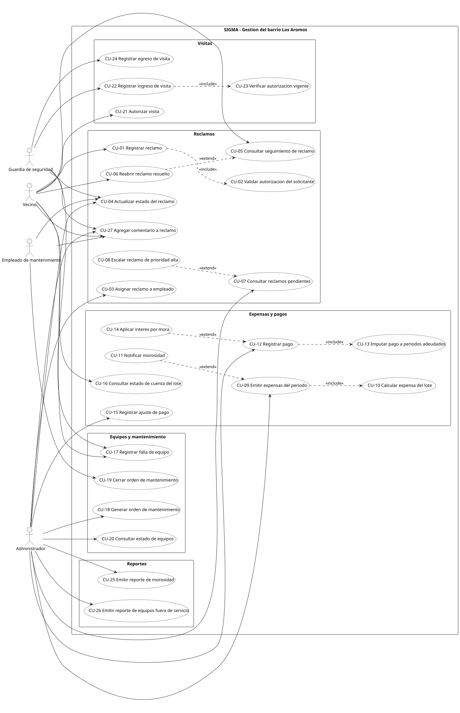

# SIGMA — Casos de uso

## Diagrama

Fuente editable: [casos-de-uso.puml](uml/casos-de-uso.puml).

## Relaciones include y extend

| Relación | Tipo | Por qué |
| --- | --- | --- |
| CU-01 → CU-02 | include | RN-07 exige validar siempre que el solicitante sea el titular o un autorizado |
| CU-09 → CU-10 | include | Emitir las expensas implica siempre calcular el importe de cada lote (RN-08) |
| CU-12 → CU-13 | include | Todo pago, total o parcial, se imputa con el criterio de RN-10 |
| CU-17 → CU-18 | include | RN-14 establece que toda falla genera una orden, con la prioridad según el tipo de equipo |
| CU-22 → CU-23 | include | RN-17 impide habilitar un ingreso sin verificar la autorización |
| CU-06 → CU-05 | extend | Reabrir es opcional y solo si el reclamo está resuelto y no pasaron 5 días (RN-03) |
| CU-08 → CU-07 | extend | El escalado ocurre solo si hay un reclamo alto sin atender hace más de 24 horas (RN-06) |
| CU-11 → CU-09 | extend | La notificación de morosidad se dispara solo si el lote supera los tres períodos impagos (RN-11) |
| CU-14 → CU-12 | extend | El interés se aplica solo si el pago es posterior al vencimiento (RN-09) |

En include, la flecha va del caso base al incluido. En extend, va de la extensión al caso base. Las relaciones de este borrador se revisarán junto con los diagramas de secuencia.

## Módulo Reclamos

### CU-01 Registrar reclamo

- Actor: Vecino
- Precondición: El vecino está registrado como titular o residente autorizado de un lote.
- Flujo principal: 1) Selecciona el lote. 2) El sistema valida la autorización (CU-02). 3) Ingresa tipo, descripción y fecha. 4) El sistema asigna la prioridad según el tipo (RN-01). 5) Crea el reclamo en estado abierto y registra el primer cambio de estado. 6) Devuelve el número de reclamo.
- Alternativos: A1) El solicitante no está autorizado: se rechaza y se informa el motivo. A2) El tipo es inválido: se solicita de nuevo.

### CU-02 Validar autorización del solicitante (incluido)

- Actor: ninguno (invocado por CU-01)
- Precondición: Existe el lote indicado.
- Flujo principal: 1) Busca la residencia vigente de la persona en el lote. 2) Verifica que sea titular o residente autorizado. 3) Devuelve el resultado.
- Alternativos: A1) No hay residencia vigente: devuelve no autorizado.

### CU-03 Asignar reclamo a empleado

- Actor: Administrador
- Precondición: Existe un reclamo en estado abierto.
- Flujo principal: 1) Selecciona el reclamo. 2) El sistema muestra los empleados con menos de 5 reclamos en curso. 3) Elige uno. 4) Asigna el responsable y pasa el reclamo a asignado, registrando el cambio.
- Alternativos: A1) El empleado llegó al límite de 5 (RN-05): el sistema lo rechaza. A2) El reclamo no está en estado abierto: no se permite asignar.

### CU-04 Actualizar estado del reclamo

- Actor: Empleado de mantenimiento, Administrador
- Precondición: El reclamo está asignado al empleado que lo actualiza.
- Flujo principal: 1) Selecciona el reclamo. 2) El sistema ofrece únicamente el estado siguiente (RN-02). 3) Ingresa una observación. 4) Se registra el cambio con fecha, estado y observación.
- Alternativos: A1) Intenta saltear estados: el sistema lanza una excepción de transición inválida. A2) El reclamo ya está cerrado: no admite cambios.

### CU-05 Consultar seguimiento de reclamo

- Actor: Vecino
- Precondición: El vecino presentó al menos un reclamo.
- Flujo principal: 1) Consulta sus reclamos. 2) Selecciona uno. 3) El sistema muestra los datos, el historial de cambios de estado y los comentarios.
- Alternativos: A1) No tiene reclamos: se informa la lista vacía.

### CU-06 Reabrir reclamo resuelto (extiende CU-05)

- Actor: Vecino
- Precondición: El reclamo está en estado resuelto y no pasaron 5 días.
- Flujo principal: 1) Selecciona el reclamo resuelto. 2) Indica el motivo. 3) El sistema lo devuelve a en curso y registra el cambio.
- Alternativos: A1) Pasaron más de 5 días: el sistema lo cierra y rechaza la reapertura (RN-03).

### CU-07 Consultar reclamos pendientes

- Actor: Administrador
- Precondición: Ninguna.
- Flujo principal: 1) Solicita el listado. 2) El sistema devuelve los reclamos no cerrados ordenados por prioridad y fecha. 3) Marca los que superan las 24 horas sin atención.
- Alternativos: A1) No hay pendientes: se informa la lista vacía.

### CU-08 Escalar reclamo de prioridad alta (extiende CU-07)

- Actor: Administrador
- Precondición: Existe un reclamo de prioridad alta sin atender hace más de 24 horas.
- Flujo principal: 1) El sistema detecta la condición al consultar. 2) Genera el aviso de escalamiento. 3) Lo registra en el historial del reclamo.

## Módulo Expensas y pagos

### CU-09 Emitir expensas del período

- Actor: Administrador
- Precondición: Está cargado el presupuesto del mes y no se emitieron las expensas de ese período.
- Flujo principal: 1) Indica período y presupuesto. 2) Para cada lote, el sistema calcula la expensa (CU-10). 3) Asigna el vencimiento el día 10. 4) Genera las expensas en estado impaga.
- Alternativos: A1) El período ya fue emitido: se rechaza la operación.

### CU-10 Calcular expensa del lote (incluido)

- Actor: ninguno (invocado por CU-09)
- Flujo principal: 1) Obtiene el coeficiente de participación del lote. 2) Multiplica el presupuesto por el coeficiente (RN-08). 3) Devuelve el importe.

### CU-11 Notificar morosidad (extiende CU-09)

- Actor: Administrador
- Precondición: El lote supera los tres períodos impagos.
- Flujo principal: 1) El sistema detecta la condición al emitir. 2) Marca el lote como moroso. 3) Registra la notificación formal al titular.

### CU-12 Registrar pago

- Actor: Administrador
- Precondición: El lote tiene al menos una expensa impaga.
- Flujo principal: 1) Selecciona el lote. 2) Ingresa fecha, importe y medio de pago. 3) El sistema imputa el pago (CU-13). 4) Actualiza el estado de las expensas alcanzadas. 5) Si el lote quedó al día, le quita la condición de moroso.
- Alternativos: A1) El importe es cero o negativo: se rechaza. A2) El lote no tiene deuda: se informa y no se registra.

### CU-13 Imputar pago a períodos adeudados (incluido)

- Actor: ninguno (invocado por CU-12)
- Flujo principal: 1) Ordena las expensas impagas de más antigua a más nueva. 2) Por cada una, imputa primero a intereses y después a capital (RN-10). 3) Genera una imputación por cada aplicación. 4) Si sobra saldo, lo deja como saldo a favor.

### CU-14 Aplicar interés por mora (extiende CU-12)

- Actor: Administrador
- Precondición: El pago se registra después del vencimiento de alguna expensa.
- Flujo principal: 1) El sistema calcula los días de atraso. 2) Aplica el 3 % mensual proporcional sobre el saldo impago (RN-09). 3) Suma el interés a la deuda del período antes de imputar.

### CU-15 Registrar ajuste de pago

- Actor: Administrador
- Precondición: Existe un pago registrado con error.
- Flujo principal: 1) Selecciona el pago. 2) Indica el motivo y el importe del ajuste. 3) El sistema genera un asiento de ajuste y recalcula el saldo, sin borrar el pago original (RN-12).

### CU-16 Consultar estado de cuenta del lote

- Actor: Vecino
- Precondición: El vecino es titular o residente del lote.
- Flujo principal: 1) Selecciona el lote. 2) El sistema muestra las expensas con su estado, los pagos imputados, los intereses y el saldo total.
- Alternativos: A1) No es titular ni residente del lote: se deniega el acceso.

## Módulo Equipos y mantenimiento

### CU-17 Registrar falla de equipo

- Actor: Vecino, Guardia de seguridad
- Precondición: El equipo existe y está en estado operativo.
- Flujo principal: 1) Selecciona el equipo por código o sector. 2) Describe la falla. 3) El sistema pasa el equipo a con falla. 4) Genera la orden de mantenimiento (CU-18).
- Alternativos: A1) El equipo ya está con falla o en reparación: se agrega la descripción a la orden abierta sin generar una nueva.

### CU-18 Generar orden de mantenimiento (incluido, también invocable por el Administrador)

- Actor: Administrador
- Flujo principal: 1) El sistema determina la prioridad según el tipo de equipo (RN-14). 2) Si es luminaria y hay más de 3 falladas en el sector, eleva la prioridad a alta. 3) Crea la orden con fecha de apertura y descripción. 4) El administrador le asigna un empleado de mantenimiento según su especialidad (SUP-06).
- Alternativos: A1) No hay empleados con la especialidad requerida: la orden queda sin asignar.

### CU-19 Cerrar orden de mantenimiento

- Actor: Empleado de mantenimiento
- Precondición: La orden está abierta y asignada al empleado.
- Flujo principal: 1) Selecciona la orden. 2) Ingresa fecha de cierre, técnico y descripción de la reparación. 3) El sistema cierra la orden y pasa el equipo a operativo.
- Alternativos: A1) Falta alguno de los tres datos: el sistema impide el cierre (RN-16). A2) El equipo no se pudo reparar: pasa a fuera de servicio.

### CU-20 Consultar estado de equipos

- Actor: Administrador
- Flujo principal: 1) Solicita el listado, con filtro opcional por sector o estado. 2) El sistema muestra cada equipo con su estado y sus órdenes abiertas. 3) Marca las cámaras sin funcionar hace más de 48 horas (RN-15).

## Módulo Visitas

### CU-21 Autorizar visita

- Actor: Vecino
- Precondición: El vecino es titular o residente del lote.
- Flujo principal: 1) Ingresa nombre y documento del visitante. 2) Indica fecha y franja horaria. 3) Si es proveedor habitual, marca la autorización como recurrente hasta 30 días (RN-18). 4) El sistema registra la autorización.
- Alternativos: A1) La recurrencia supera los 30 días: se rechaza. A2) Ya existe una autorización vigente para esa persona y lote: se informa y no se duplica.

### CU-22 Registrar ingreso de visita

- Actor: Guardia de seguridad
- Precondición: El guardia está en el puesto de portería.
- Flujo principal: 1) Ingresa el documento del visitante. 2) El sistema verifica la autorización (CU-23). 3) Registra la hora de ingreso y el guardia que lo habilitó.
- Alternativos: A1) No hay autorización vigente: el sistema lanza una excepción y no habilita el ingreso (RN-17). A2) La persona tiene un ingreso sin egreso: se rechaza (RN-19).

### CU-23 Verificar autorización vigente (incluido)

- Actor: ninguno (invocado por CU-22)
- Flujo principal: 1) Busca autorizaciones del visitante por documento. 2) Verifica que la fecha y la hora actuales estén dentro de la vigencia y la franja. 3) Devuelve la autorización o el motivo del rechazo.

### CU-24 Registrar egreso de visita

- Actor: Guardia de seguridad
- Precondición: Existe un registro de ingreso sin egreso para esa persona.
- Flujo principal: 1) Busca el ingreso abierto por documento. 2) Registra la hora de egreso.
- Alternativos: A1) No hay ingreso abierto: se informa el error.

## Módulo Reportes

### CU-25 Emitir reporte de morosidad

- Actor: Administrador
- Flujo principal: 1) Solicita el reporte. 2) El sistema lista los lotes con deuda, ordenados por importe adeudado, indicando períodos impagos, intereses y condición de moroso. 3) Lo exporta a archivo.

### CU-26 Emitir reporte de equipos fuera de servicio

- Actor: Administrador
- Flujo principal: 1) Solicita el reporte. 2) El sistema lista los equipos en estado con falla, en reparación o fuera de servicio, agrupados por sector, con sus órdenes abiertas. 3) Lo exporta a archivo.

El reporte de reclamos pendientes que pide el enunciado está cubierto por CU-07, así que no lo duplicamos. Dejalo aclarado en el informe para que no parezca un olvido.

## Módulo Reclamos — cobertura de comentarios

### CU-27 Agregar comentario a reclamo

- Actor: Vecino solicitante, Empleado de mantenimiento responsable.
- Precondición: Existe el reclamo y quien comenta es su solicitante o responsable asignado.
- Flujo principal: 1) Selecciona el reclamo. 2) Ingresa un texto no vacío. 3) El sistema guarda el comentario con autor y fecha. 4) Lo muestra en el seguimiento del reclamo.
- Alternativos: A1) Texto vacío: se solicita un comentario válido. A2) Actor sin acceso al reclamo: se deniega la operación.
- Trazabilidad: RF-04. La restricción de acceso es una propuesta de diseño que debe confirmarse en el modelado.
